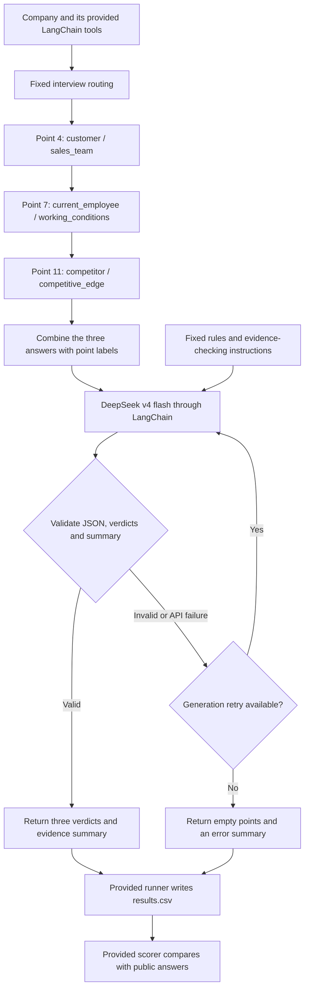

# FTEC5660 Homework 3: Fisher's 15-Point Investment Agent

Build a LangChain agent that researches a company with tools and applies the
framework from Philip Fisher's *Common Stocks and Uncommon Profits* (Part One,
Chapter 3 "What to buy: the fifteen points to look for in a common stock", and
Chapter 4 "What to buy: applying this to your own needs"). You choose 3 of
Fisher's 15 points and decide yourself what PASS means for each. For every
company your agent gives a PASS/FAIL verdict on your 3 points and a short
summary.

The companies are fictional, so the model cannot answer from memory. Unlike a
pile of reports, the evidence is spread over three sources, and your agent has
to go and get it with tools, the way Fisher's "scuttlebutt" method sends an
investor to talk to customers, competitors, suppliers and staff.

## Data and tools

`public_test/` has one folder per company. Your code receives four tools per
company (built by the provided code in `hw3.py`):

| Tool | What it gives you |
| --- | --- |
| `list_documents()` | the company's six documents and their dates |
| `read_document(name)` | one document: the 2025 letter to shareholders, four earnings calls (Q3 2025 to Q2 2026) and a news file (July 2025 to July 2026) |
| `sql_query(query)` | one read-only SQLite query on the company's database; at most 50 rows come back, so use `SUM`, `GROUP BY` and `WHERE` |
| `interview(role, topic)` | what one person says about the company; at most **10 interviews per company** |

The documents are what management says. Management's own claims (such as "we
have never cut research" or "our people are our greatest strength") are not
evidence on their own: check them against the database and the interviews.

**Database tables** (amounts in USD thousands; dates `YYYY-MM-DD`, months
`YYYY-MM`, quarters like `2025Q3`; the fiscal year is the calendar year):

| Table | Columns |
| --- | --- |
| `company` | name, industry |
| `industry_medians` | industry, revenue_growth_2y_pct, new_product_share_pct, new_product_sales_per_rd, operating_margin_pct (one row per industry; use the row for the company's own industry) |
| `orders` | order_id, order_date, product, customer, amount, note (about 3,000 to 4,000 orders from January 2023 to June 2026; revenue is the sum of order amounts) |
| `products` | product, launch_date |
| `monthly_costs` | month, cost_of_sales, selling_admin, research_development |
| `quarterly_cash` | quarter, operating_cash_flow, capex, cash_end |
| `capex_plan` | year, planned_capex (2026 to 2028) |
| `returns` | month, units_shipped, units_returned |
| `insider_trades` | trade_date, person, title, side (`buy` or `sell`), shares, price |

**Terms used in the data.**

| Term | Meaning |
| --- | --- |
| FY2025 | Fiscal year 2025. Here the fiscal year is the calendar year, so FY2025 is January to December 2025. |
| Quarter | Three months of the year: Q1 is January to March, Q2 April to June, Q3 July to September and Q4 October to December. The database writes `2025Q3`; the documents write "third quarter 2025". |
| Amounts | The database is in **USD thousands** (676,100 means US$676.1 million). The documents use USD millions. |
| Revenue | Money from sales: the sum of `amount` in `orders`. |
| Cost of sales | The cost of making the products that were sold. |
| Selling and admin | The cost of selling and of running the company (sales staff, offices, management). |
| R&D | Research and development spending, mainly on new products. |
| Operating margin | Operating profit as a share of revenue: (revenue − cost of sales − selling and admin − R&D) ÷ revenue. |
| Operating cash flow | Cash that the day-to-day business brings in during a quarter. |
| Cash at the end of a quarter | The cash the company holds on the last day of that quarter (`cash_end`). |
| Capex | Capital expenditure: spending on factories, machines and other long-term assets. `capex_plan` holds the planned capex for 2026 to 2028. |
| Return rate | Units returned ÷ units shipped, from the `returns` table. |
| Industry median | The middle value for companies in the same industry, from `industry_medians`. |
| Insider | A director or senior manager of the company. `insider_trades` lists the shares they bought (`buy`) or sold (`sell`). |
| Earnings call | A meeting each quarter where management presents the quarter's results to investors. Each call quotes that quarter's revenue. |

**Interviews.** Roles: `customer`, `current_employee`, `former_employee`,
`competitor`, `supplier`. Topics: `sales_team`, `working_conditions`,
`top_management`, `decision_making`, `competitive_edge`. Only some people know
about each topic; the others say they can't comment, and that answer still
uses up one interview.

| Topic | Who knows about it |
| --- | --- |
| `sales_team` | customer, competitor |
| `working_conditions` | current_employee, former_employee |
| `top_management` | former_employee, supplier |
| `decision_making` | supplier, customer |
| `competitive_edge` | competitor, customer |

People who know about a topic always agree with each other, so one good answer
is enough.

## Choose your 3 points and your rules

Pick any 3 of Fisher's 15 points and write them in `CHOSEN_POINTS` near the
top of `hw3.py`, e.g. `CHOSEN_POINTS = [1, 7, 15]`. The full questions are in
`FISHER_POINTS` in `hw3.py` and in the book.

| # | Fisher's point | Where the evidence is |
| --- | --- | --- |
| 1 | Market potential for sales growth | database |
| 2 | New products as current lines mature | database |
| 3 | Effective research and development | database |
| 4 | Above-average sales organization | interviews (`sales_team`) |
| 5 | Worthwhile profit margin | database |
| 6 | Maintaining or improving margins | database |
| 7 | Labour and personnel relations | interviews (`working_conditions`) |
| 8 | Executive relations | interviews (`top_management`) |
| 9 | Depth of management | interviews (`decision_making`) |
| 10 | Cost analysis and accounting controls | earnings calls, checked against the database |
| 11 | Advantage over competitors | interviews (`competitive_edge`) |
| 12 | Long-range outlook on profits | database |
| 13 | Growth without dilutive equity financing | database |
| 14 | Management talks freely about troubles | earnings calls, checked against the database |
| 15 | Management of unquestionable integrity | news file, checked against the database |

For each of your points, **you design the rule**: which evidence to use, what
to compute or whom to ask, and where the line between PASS and FAIL lies. PASS
means the company looks favourable on that point, as Fisher would see it.

We grade your verdicts against our own answer key. It uses one fixed rule per
point, which we do not publish, and the data never puts a company close to
the line of that rule, so a sensible reading of Fisher usually gives the same
answer. **Test your rules on the public answers**:
`public_test/ground_truth.json` gives the expected verdict on all 15 points
for each of the 20 public companies, and every point fails in 6 of them. If
your rule disagrees with the public answers, rethink it.

**Tip: calculate with tools, not in your head.** Do every sum, ratio and
comparison in SQL or Python, including the number of days between two dates
(SQLite's `julianday()` gives a date as a number of days).

## Student task

Fill in the three places in `hw3.py` marked `### YOUR CODE HERE`. You may add
imports, constants and helper functions above them, but do not change the
provided code below them:

- `CHOSEN_POINTS` lists your 3 points.
- `build_agent()` creates your model and anything else you need once.
- `analyze_companies(agent, companies)` receives
  `{company_folder: [list_documents, read_document, sql_query, interview]}`
  and returns, for every company,
  `{"points": {1: "PASS", 7: "FAIL", 15: "PASS"}, "summary": "..."}` (here with
  `CHOSEN_POINTS = [1, 7, 15]`).

Use the course techniques that fit your points: tool use for the database and
the interviews, planning which interviews to spend, routing each point to the
right source, prompt chaining, parallel calls, reflection to check your
answers, or a combination. Your code must read company data **only through
the four tools**; do not open `company.db` or `interviews.dat` yourself. Do
not hard-code folder names, company names or the public answers.

## Setup and public test

```bash
python3 -m venv .venv
source .venv/bin/activate
pip install -r requirements.txt
echo "DEEPSEEK_API_KEY=your_key_here" > .env
python3 hw3.py --data-folder public_test
```

Use your own DeepSeek API key (from https://platform.deepseek.com). The
required model is `deepseek-v4-flash`. We grade with our own key, so never put
a key in your code; `.env` must stay out of git.

The program creates `results.csv` with the columns `company`, `points`,
`points_correct`, `point_errors`, `interviews_used` and `summary`, and prints
the point score on your 3 points (the percentage after "balanced"). The point
score is the average of two shares: the share of truly passing verdicts that
you marked PASS and the share of truly failing verdicts that you marked FAIL.
For example, 90% and 60% give (90% + 60%) / 2 = 75%, and marking every point
PASS gives (100% + 0%) / 2 = 50%. Once `CHOSEN_POINTS` is set, the starter
runs before you add any API code (it returns no verdicts, so it scores 0%).

`public_test/ground_truth.json` gives the expected verdicts on all 15 points
for each public company. Grading uses a private set of about 20 unseen
companies with the same tools and the same answer key rules, but different
names and wording, and scores your 3 points only.

## Homework 3 solution

### My 3 points and rules

I selected points **4, 7 and 11**. Together, they examine customer-facing execution, employee relations and competitive positioning. These qualitative criteria suit Fisher's scuttlebutt approach and can be assessed through the knowledgeable interviewees specified in the assignment. Each criterion has a fixed rule applied to every company.

| Point | Why I chose it | PASS/FAIL rule | Evidence used |
| --- | --- | --- | --- |
| **4: Above-average sales organization** | Sales quality depends on how effectively the team understands and supports customers, which customers can describe directly. | PASS when the sales team provides knowledgeable advice, effective support or service beyond simply quoting prices. FAIL when salespeople are passive or poorly informed, or customers must seek advice from rivals. | `interview(role="customer", topic="sales_team")` |
| **7: Labour and personnel relations** | Employee experience provides evidence about fair treatment and the quality of the relationship between staff and management. | PASS when employees describe fair treatment, constructive personnel relations and good working conditions. FAIL when they describe persistent mistreatment, poor conditions or serious distrust. | `interview(role="current_employee", topic="working_conditions")` |
| **11: Advantage over competitors** | Competitive positioning helps distinguish a business with lasting strengths from one competing mainly on price. | PASS when evidence identifies a meaningful, defensible advantage, such as capabilities that are difficult to copy, strong customer relationships or switching costs. FAIL when the offering is easily copied or replaced and lacks a durable advantage. | `interview(role="competitor", topic="competitive_edge")` |

The positive examples illustrate the rules; a company does not have to demonstrate every example to pass. The model judges each point independently from the corresponding evidence. One informed interview per topic is sufficient under the assignment's explicit assumption that knowledgeable interviewees agree. Thus, each company uses **3 of the 10 available interviews**.

### Design



The implementation is a routed agent workflow: Python selects and invokes the provided LangChain interview tool for each criterion, and `ChatDeepSeek` interprets the resulting evidence using `deepseek-v4-flash`. Interviews are sequential within each company; up to four companies are processed concurrently. In the normal successful path, the three answers are combined into one model request. The prompt specifies the decision rules, asks the model to check each verdict against its own quotation (including negation), and requests three short explanatory sentences. This check occurs within the same request, rather than through a separate reviewer model. Interview quotations are explicitly treated as data, not instructions. The model is configured with temperature 0 and JSON-object output, and Python validates all three verdicts and a nonempty summary before returning a result.

**Reliability and constraints.** A failed or invalid generation is retried once using the same evidence, without spending additional interviews. The model client also allows one transport-level retry; each workflow attempt has a 90-second outer timeout. Errors are caught separately for each company, so a failed company returns an error summary and empty points instead of stopping the full run or inventing verdicts. Empty points are counted as incorrect by the scorer. The analysis reads company data only through the supplied interview tool; it does not directly access the database or interview file, use web search, or supply public answers to the model. No company names or expected verdicts are hard-coded. The provided tools, runner and scoring code are unchanged.

### Results

One end-to-end public test run was completed on **20 November 2026** with:

```bash
python3 hw3.py --data-folder public_test
```

The program reported:

```text
Processed 20 companies. Wrote results.csv. Your points: 4, 7, 11. Point accuracy: 60/60 (balanced: 100.0%).
```

| Measure | Observed result |
| --- | --- |
| Companies processed | 20 |
| Selected points | 4, 7, 11 |
| Correct verdicts | 60 / 60 |
| Correct verdicts on true-PASS cases | 42 / 42 (100%) |
| Correct verdicts on true-FAIL cases | 18 / 18 (100%) |
| Balanced point accuracy | 100.0% |
| Interviews per company | 3 |
| Total interviews | 60 |
| Nonempty company summaries | 20 / 20 |
| Companies disagreeing with public answers | None |

Balanced accuracy is the mean of the recall on the two verdict classes:

```text
Balanced accuracy = (42/42 + 18/18) / 2 = 100%
Equivalent Task 1 score on this public run = 1.00 × 75 = 75/75
```

All rows in `results.csv` have `points_correct` equal to `3/3` and an empty `point_errors` field. There are therefore no public-test disagreements to explain for this run. For example, the generated summary for `ashgrove_labs` identifies passive price-list sales, constant overtime and resignations, and easily copied offerings; the three FAIL verdicts match the public answers. For `bramble_labs`, knowledgeable customer support and positive personnel relations support PASS on points 4 and 7, while easy imitation supports FAIL on point 11.

These results come from one public run, not three private evaluation runs. They do not guarantee the same score on unseen companies. The workflow benefits from the assignment's clear-cut evidence and agreement among informed interviewees; real-world interviews may be ambiguous or contradictory and would require broader verification. The automatic scorer checks verdicts, not the factual accuracy of every sentence in the summaries.

## Task 2: Reflection on AI Sycophancy and AI Psychosis

AI sycophancy occurs when an AI system prioritizes agreeing with a user over giving an accurate, independent assessment. In a business setting, this could mean endorsing an investment idea because the user sounds enthusiastic, rather than evaluating the evidence. A fluent and confident explanation can make this agreement appear more reliable than it actually is.

This homework illustrates why explicit criteria matter. My agent evaluates three Fisher points using predefined rules and relevant interview evidence. It is instructed to judge each point independently, rather than produce a generally positive impression of a company. However, these instructions do not eliminate the possibility of biased interpretation. If I changed the prompt to suggest that a company was an excellent investment, a robust agent should still return the same evidence-based verdicts. Comparing results under differently framed prompts would be a useful future test; I have not performed that test in this submission.

I understand “AI psychosis” here as an informal term for situations where interactions with AI may reinforce a person's distorted beliefs or weaken their ability to distinguish generated claims from reality. It should not be taken to mean that an AI system itself has a human psychiatric condition. A concern is that repeated, personalized agreement could make an unsupported belief feel independently confirmed. In such situations, an AI should acknowledge the person's feelings without presenting their unsupported interpretation as fact, communicate uncertainty, and encourage appropriate human support.

Both issues involve a failure to maintain a clear boundary between evidence and persuasive language. In this assignment, the public answer key provides an external check: my agent achieved 100% balanced accuracy on one public run. Nevertheless, that result does not establish that every explanation is correct or that the agent will perform equally well on unseen data. Treating a perfect test score as proof of universal reliability would itself be an unjustified conclusion.

My main takeaway is that useful AI should be able to disagree, explain what supports its conclusions, and admit when it cannot produce a reliable answer. In my implementation, an unresolved processing failure produces an error entry rather than fabricated verdicts. For more realistic applications, I would also want contradictory evidence checks, tests for sensitivity to leading prompts, and human review before consequential decisions.
